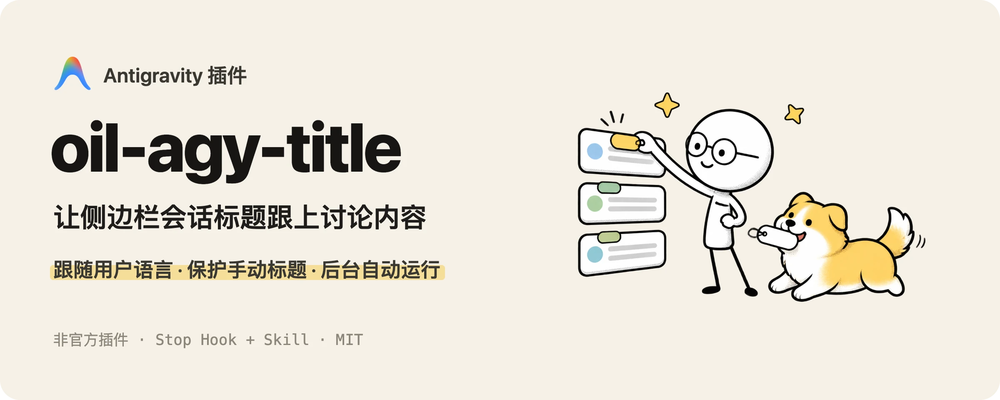
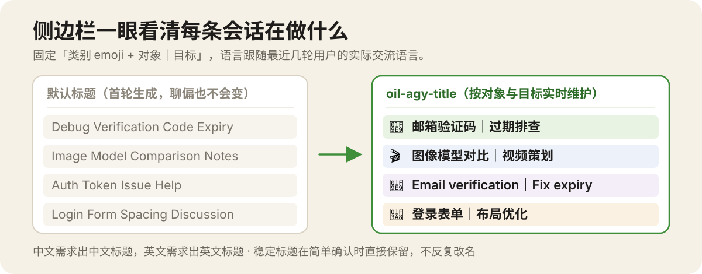
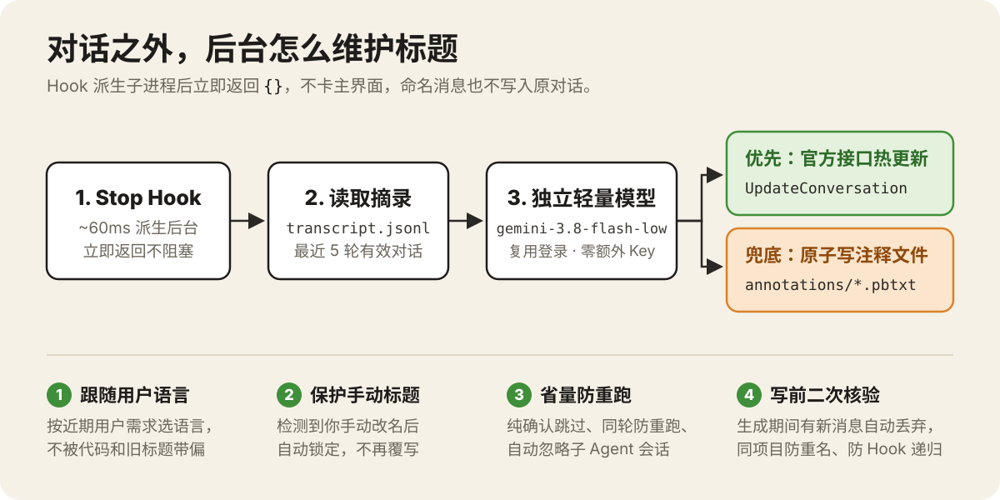

<p align="center">
  
</p>

`oil-agy-title` 是一个 Antigravity 桌面端插件，打包了 `Stop` Hook 和配套管理 Skill。每轮对话结束后，它在后台用独立的轻量模型检查最近几轮讨论，自动维护「类别 emoji + 对象｜目标」格式的会话标题；主题没变就保持原样，命名过程不进入原对话。

> 这是个人做的非官方插件，和 Google 没有关系。命名规范与并发保护设计参考了 [oil-codex-title](https://github.com/oil-oil/oil-codex-title)。

<p align="center">
  
</p>

## 为什么做这个插件

Antigravity 桌面端默认只在第一轮自动起一次标题，而且经常起成英文短语；聊着聊着换了重点、修了具体模块，或者开着十几个并行会话时，侧边栏很难一眼分清哪条在做什么。

`oil-agy-title` 把标题维护从对话里拆出去：

- **一眼区分对象和目标**：统一用 `emoji 对象｜目标`（恰好一个全角 `｜`），把具体模块、工具或主题放在最前面。
- **跟着用户的语言走**：依据最近几轮**用户自己表达需求**的主要语言决定标题语言，不因为旧英文标题、助手回复、代码片段或日志把标题带偏；偶尔夹杂一句外语或技术名词不会来回切换，持续换用另一种语言后自动迁移。
- **不覆写手动标题**：建立稳定基线后，一旦检测到你在桌面端手动改了标题，自动锁定该会话，不再改动。
- **克制消耗**：纯确认回复（「好的」「继续」「ok」）最多连续免模型跳过两轮；后台子任务中途回报不重复触发；子 Agent 与已归档会话直接跳过。

## 类别与命名格式

标题按持续工作的产物归类，不随「修复」「提交」「测试」等临时动作频繁换图标：

| 类别 | emoji | 适用场景 | 示例 |
| --- | :---: | --- | --- |
| 工具开发 | 🧩 | 功能开发、缺陷修复、插件、Skill 与自动化脚本 | `🧩 邮箱验证码｜过期排查` / `🧩 Email verification｜Fix expiry` |
| 内容制作 | 🎬 | 视频选题、脚本、拍摄、剪辑与发布 | `🎬 图像模型对比｜视频策划` |
| 对比调研 | 🔎 | 模型对比、方案评估、资料与岗位调研 | `🔎 向量数据库｜检索方案对比` |
| 页面设计 | 🎨 | 界面布局、视觉稿、动效与样式还原 | `🎨 登录表单｜布局优化` |
| 方法整理 | 📝 | 规范文档、操作指南、文章与演示文稿 | `📝 镜头语言｜制作方法整理` |
| 日程安排 | 📅 | 带明确时间节点的日程、提醒与待办 | `📅 周一例会｜议程整理` |
| 环境配置 | ⚙️ | 安装、权限、账号与本地运行环境配置 | `⚙️ 本地代理｜端口与证书配置` |
| 一般讨论 | 💬 | 有明确对象但不属于以上类别的讨论 | `💬 团队分工｜边界讨论` |

## 工作原理

<p align="center">
  
</p>

1. **非阻塞触发**：Antigravity 的 `Stop` Hook 目前为同步执行，插件入口会在约 60ms 内派生脱离会话的后台 worker 并立即输出 `{}` 返回，不阻塞交互，同时通过环境变量与桌面端路径双重防止递归触发。
2. **双通道写回**：
   - 当运行环境注入了本地服务变量（`ANTIGRAVITY_LS_ADDRESS`、`ANTIGRAVITY_CSRF_TOKEN`，例如在对话中通过 Skill 手动触发改名）时，优先调用 Antigravity 官方本地接口 `product.v1.ConversationService/UpdateConversation` 实时热更新侧边栏、SQLite 与全文检索索引。
   - 当后台 `Stop` Hook 环境未注入本地服务变量时，自动降级为原子更新 `~/.gemini/antigravity/annotations/<id>.pbtxt`（桌面端重载或刷新会话状态后同步到列表与索引）。

## 安装

需要 macOS（Linux 理论兼容但未实测桌面端）、Python 3.9+、Antigravity 桌面端以及已登录的 `agy` CLI（或任意外部 OpenAI 兼容 API）。

```bash
git clone https://github.com/oil-oil/oil-agy-title.git
```

```bash
agy plugin install oil-agy-title/plugin
```

没有用 `agy plugin install` 的话，也可以直接把 `plugin` 目录复制进全局插件目录：

```bash
cp -R oil-agy-title/plugin ~/.gemini/config/plugins/oil-agy-title
```

装好后无需手动修改 `config.json`，新开一条桌面端会话聊一轮即可生效。桌面端的 Customizations / Plugins 面板里也能直接开关 `Oil AGY Title`。

## 日常怎么用

装好后直接对 Antigravity 说即可（由内置 Skill 调用脚本）：

- 「检查 oil-agy-title 的运行状态和 Hook」
- 「预览当前对话的新标题」 / 「给当前对话重新命名」
- 「固定当前对话的标题」 / 「解锁当前对话标题」
- 「暂停自动命名」 / 「恢复自动命名」
- 「查看自动命名模型用量」

也可以直接在终端运行脚本：

```bash
P="$HOME/.gemini/config/plugins/oil-agy-title/scripts/oil_agy_title.py"

python3 "$P" doctor              # 检查环境、agy CLI 与当前会话读取
python3 "$P" status              # 查看配置、已跟踪会话数与最近 5 条日志
python3 "$P" usage               # 汇总独立命名模型调用次数与 token 用量
python3 "$P" rename <会话ID>      # 仅预览，不写入
python3 "$P" rename <会话ID> --apply
python3 "$P" lock <会话ID>        # 固定标题，阻止后续自动改名
python3 "$P" unlock <会话ID>
python3 "$P" pause               # 全局暂停
python3 "$P" resume              # 全局恢复
```

## 模型选择与提速

默认使用 **`agy` 内置的 `gemini-3.8-flash-low`**，直接复用现有 Antigravity 登录，无需另外配置 API Key。在 macOS 实测中，单回合耗时约 **11 秒**（相比 `gemini-4-argon-low` 约 22 秒、`gpt-oss-120b-medium` 约 21 秒是内置里最快的），`thinking_tokens=0`，提示词缓存命中率约 80%。

如果你希望把后台命名压到 **1～3 秒** 且省去 `agy` CLI 启动时的系统提示词输入开销，可以切换到任意 OpenAI 兼容的轻量模型接口（例如 Flash-Lite、DeepSeek、Qwen 或聚合网关）。插件只保存环境变量名，不落盘明文密钥：

```bash
python3 "$HOME/.gemini/config/plugins/oil-agy-title/scripts/oil_agy_title.py" configure \
  --provider openai_compatible \
  --api-base-url https://your-endpoint.example/v1 \
  --api-key-env YOUR_API_KEY_ENV \
  --model your-fast-model
```

恢复默认内置模型：

```bash
python3 "$HOME/.gemini/config/plugins/oil-agy-title/scripts/oil_agy_title.py" configure \
  --provider agy \
  --model gemini-3.8-flash-low
```

## 数据、隐私与局限

- **本地数据存放**：配置、单会话跟踪基线、文件锁、精简审计日志与用量账本全部保存在 `~/.gemini/antigravity/plugin_data/oil-agy-title/`，不保存完整对话原文或提示词。
- **后台生效时机**：实测当前 Antigravity 桌面版执行 `Stop` Hook 时未向 Hook 进程注入 `ANTIGRAVITY_LS_ADDRESS`，因此后台自动触发走 `.pbtxt` 原子写入兜底；该文件已被桌面端用作标题真源，但在应用重载或同步前，侧边栏可能不会秒级热刷新。通过对话内 Skill 手动执行 `rename --apply` 时走官方 `UpdateConversation` 接口，可立即热刷新。
- **历史会话不批量改动**：只对安装后产生新对话轮次的会话生效，不会主动扫描和重命名旧历史。
- **平台验证范围**：目前在 macOS（Python 3.9 与 3.14）通过单元测试与桌面端真实对话验证；Linux 与 Windows 桌面端尚未实测。

## 许可证

[MIT](LICENSE)
